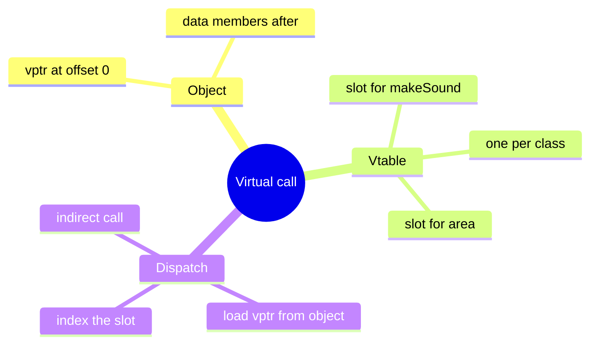

# Polymorphism

I keep the words apart: virtual dispatch is a mechanism, polymorphism is a design consequence. The page measures the vtable in a small program, then adds `override` and `final`, then derives a pure interface, then demonstrates slicing with a function that takes a base by value. The cost section is numerical rather than rhetorical: one indirection, one branch, and a devirtualisation that the optimiser will do when it can prove the dynamic type.

A virtual function is a pointer stored in the object. That single sentence explains the layout, the cost, the slicing defect, and why a virtual call cannot be inlined without devirtualisation.



## 1. The layout, measured

```cpp
// LAB 05-01  cpp_polymorphism/01_vtable_probe.cpp
struct Animal {
    virtual void speak() { std::cout << "generic\n"; }
    virtual ~Animal() = default;
    int weight;
};
```

`sizeof(Animal)` is 16 on x86-64: 8 for the vptr, 4 for `weight`, 4 for padding. The vptr is the first member, which is why a base subobject and the derived object share an address even when virtual functions are present.

`Animal` has a vtable of its own, one per class, stored once in the read-only data segment. The vptr in each object points at that table. Calling `speak` compiles to roughly:

```cpp
Animal *a = ...;
a->vptr[0](a);      // load the pointer, index slot 0, pass this explicitly
```

Three operations where a non-virtual call would be one. The indirect call also defeats inlining, which is the larger cost in a tight loop.

## 2. Overriding, `override`, and `final`

```cpp
struct Dog : Animal {
    void speak() override { std::cout << "woof\n"; }
};
```

`override` is optional and should never be omitted. It asks the compiler to verify that the function really overrides a base virtual function; without it, a signature mismatch — a missing `const`, a different parameter type — silently creates a new function that hides the base one. The result compiles, runs, and calls the base implementation, which is the failure mode `override` exists to prevent.

`final` on a virtual function tells the compiler no further override is possible, which enables devirtualisation in the same translation unit. `final` on a class does the same for all its functions.

```cpp
struct Cat final : Animal { void speak() override; };
```

## 3. Pure virtual and abstract

```cpp
struct Shape {
    virtual double area() const = 0;
    virtual ~Shape() = default;
};
```

`= 0` makes the function pure: the class cannot be instantiated, and any derived class that does not define it remains abstract. The vtable slot for a pure virtual is typically a stub that calls `__cxa_pure_virtual`, which aborts — so a call through a partially constructed object terminates rather than returning garbage. That abort is a feature: it converts a lifetime defect into a diagnosable one.

An abstract class with a virtual destructor is the correct base for a polymorphic hierarchy. Without the virtual destructor, deleting through the base leaks the derived part, as the previous chapter showed.

## 4. Slicing removes the polymorphism, not just the data

```cpp
struct Circle : Shape { double r; double area() const override { return 3.14 * r * r; } };

Circle c{2.0};
Shape s = c;            // sliced
s.area();               // calls Shape's slot -> the pure-virtual stub, or a wrong value
```

`Shape s = c;` reads like a conversion, and it is worth slowing down to see that it is a construction in three steps. The compiler picks `Shape`'s copy constructor, because the declared type of `s` is `Shape`. The argument `c` binds to that constructor's `const Shape &` parameter, which exposes only the `Shape` subobject of `Circle` — for single inheritance with the base at offset 0, the address happens to equal `&c`. The copy constructor then copies exactly the layout it knows: the vptr and whatever else `Shape` declares.

The vptr is part of that layout, so the copy receives `Shape`'s table pointer. The constructor has no way to know that the source object's dynamic type was `Circle`; it was generated for `Shape`, and it copies `Shape`. This is why the defect is silent: nothing illegal happened, a base object was constructed correctly from a base subobject, and the derived part — `r`, and the override that would have read it — was simply never brought along.

Compare `Shape *p = &c;`, where nothing is constructed. A pointer holds an address, converting `Circle *` to `Shape *` adjusts that address by the base offset (zero here), and the object it points at is still the original `Circle` with `Circle`'s vptr. Every polymorphic call on the copy dispatches as `Shape` because the copy is a `Shape`.

The rule is short: polymorphic objects travel by reference or by pointer, never by value. A function parameter of type `Shape` is a defect; `const Shape &` is the fix.

## 5. What a virtual call costs

Two measurements make the cost concrete, and the lab asks for both.

A loop calling the same virtual function on the same object is devirtualised by the compiler when it can prove the dynamic type. With `final` on the class, GCC and Clang emit a direct call even at `-O1`.

A loop whose dynamic type changes per iteration cannot be devirtualised, and the cost is a load plus an indirect branch. On a modern x86-64 the difference is typically 2–4 cycles per call when the branch predictor succeeds and 15–20 when it mispredicts, which is why the order of objects in a container matters for a virtual-heavy loop.

The practical conclusion: virtual dispatch is cheap enough for anything called once per object and expensive enough to notice in a loop over a million atoms. The biology section measures exactly that case in the parallel chapter.

## 6. Field note: the derived class that forgot `override`

An early version of the animal example declared the base function as `virtual void makeSound()`, and the derived class as:

```cpp
void MakeSound() { std::cout << "Dog Sound.\n"; }   // capital M
```

Different case, so no override. The derived class had two functions: the inherited `makeSound` and a new `MakeSound` that nothing called. The program printed the base's message and the author concluded that virtual dispatch was broken.

Adding `override` turns this into a compile error: "`MakeSound` marked override, but does not override". A single keyword converts a silent behavioural defect into a diagnostic, which is the best trade in the language.

## 7. Practise

Compile `code/cpp/05_polymorphism/02_slicing.cpp`, which deliberately slices a `Circle` into a `Shape` by value, and read the output before and after changing the parameter to `const Shape &`. The exercise in `labs/cpp/05_polymorphism/` is to build a two-level hierarchy, call through a base pointer, and make a pure-virtual stub abort the program if any call reaches it — the stub is the detector, since a missed override is otherwise silent.

## Continue

- [Operator Overloading](operators.md) is dispatch on the static type, and the contrast is instructive.
- [Inheritance](inheritance.md) established the base subobject this chapter puts a vptr into.
- [Exceptions](exceptions.md) explains what happens when a virtual call occurs during construction.
