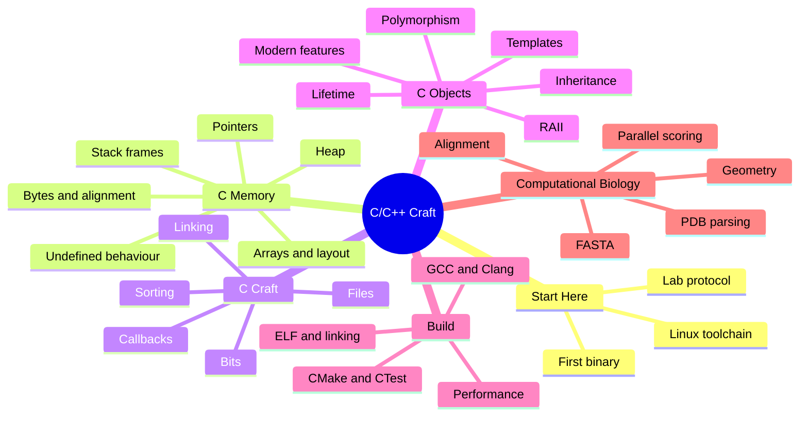

# Preface

The preface is where I say what this book is not: not a reference, not a tour of every feature, not a promise that C++ is C with classes. I state the one skill the book aims at, how the four parts are organised, how each chapter is written, what the code is and is not, and where to start depending on what you already know.

The first C program I wrote that mattered was a PDB parser. It read a file, filled a struct, and crashed on the third chain. I had been taught that a `struct` is a group of related variables, which is true the way that a house is a group of bricks: accurate, and useless when the roof leaks. What I needed to know was where the padding went, why `sizeof` disagreed with the sum of the fields, and why the pointer I had stored in the struct was still valid in one function and garbage in the next.

That gap between the definition and the layout is what this book is about. Not C as a list of syntax rules, and not C++ as a list of features, but the object model underneath both: how a value occupies bytes, how long it lives, who is allowed to name it, and what happens when the answer changes.

## 1. Why this book exists

Most introductory material teaches C by describing what a statement does. This book teaches C by describing what a statement _builds_. A declaration does not merely introduce a name; it reserves a region of memory with a width, an alignment, and a lifetime. A pointer is not merely an arrow; it is an integer that has been granted permission to be dereferenced, and that permission expires with the object it points at. A `virtual` function is not merely a keyword; it inserts a pointer at the front of every object of that class, and every polymorphic call is an indirect jump through that pointer.

Once the layout is visible, the rules stop being arbitrary. `const` is not a style preference: it is a promise about which bytes may be written. `restrict` is not a hint: it is a promise that no other pointer aliases the same region, which is why the optimiser is allowed to reorder reads. Undefined behaviour is not a punishment: it is the set of cases where the standard declines to describe what the bytes mean, and the compiler is therefore free to assume they mean nothing at all.

## 2. What the reader will be able to do

By the end, a reader should be able to take a program they did not write, and answer four questions without running it: how much memory does it touch, how long does each object live, which pointer owns each allocation, and which line will fail first under a sanitizer. Those four questions cover most of what separates a program that compiles from a program that works.

The last section of the book applies all four to protein structures: parsing a PDB file by column position, computing bond angles and dihedrals from coordinates, building a contact map with a grid instead of a double loop, and scoring a library of conformations across threads. The biology is not decoration. It is the reason the earlier chapters insist on layout: a structure with 30,000 atoms is where a wrong `sizeof` becomes a five-minute parse and a wrong ownership rule becomes a leak per chain.

## 3. How the book is organised

Six sections, in the order a program is actually built: a compiler, then bytes, then functions that operate on bytes, then objects that own bytes, then a build system that assembles them, then a domain where the bytes are atoms.

## 4. How each chapter is written

Chapters do not share a template. The memory chapters run as one continuous argument: a single picture of an object grows across nine chapters, from a lone `int` to a stack frame to an array to a struct with padding to a heap block with an owner. Reading them out of order breaks the picture, which is why they are numbered.

The craft chapters change register. Each one starts from a failure — a sort that loses a comparison, a file that reads one line short, a translation unit that links but calls the wrong function — and works forward to the tool or the rule that prevents it. They read like laboratory notes because they were written from laboratory notes.

The C++ chapters are organised around a single question repeated with increasing difficulty: when does this object begin, and when does it end. The build chapters are organised around commands and their artefacts, because that is what a build system is. The biology chapters are organised around data flow: file in, structure out, number out, error estimate.

What the chapters do share is a floor: every page carries code that compiles, every claim carries evidence in the form of a `sizeof` value, a compiler message, a timing, or an assertion, and every page ends with links into specific subsections rather than a generic "next chapter".

## 5. A note on the code in this book

The examples are not a curated set of correct programs. Several of them are wrong on purpose, and they are wrong in the way the original versions were wrong: a function whose name promises the absolute value and whose body returns the absolute value of something else; a loop condition with `==` where `!=` was meant; a two-level allocation where only the outer block is freed; a stack whose capacity check compares against the wrong bound.

Each of these appears in the chapter that would have caught it, labelled as a field note, with the original snippet, the compiler's or the debugger's actual response, and the smallest correction. A reader who only ever sees correct code learns to recognise correctness by shape. A reader who has debugged these learns to recognise it by behaviour.

## 6. Who wrote this

Mr. Su, The code in this book comes from two years from going back through the early repositories to find out which habits had to be unlearned.

Contact and the rest of the work: `suguohui_account@163.com`, [www.huimy.top](https://www.huimy.top), [blog.huimy.top](https://blog.huimy.top), [comm.huimy.top](https://comm.huimy.top).

## 7. Where to start

If the toolchain is already installed, go to [First Program](first-program.md) and build something. If it is not, [Linux Toolchain](linux-toolchain.md) takes about twenty minutes. If you want to know how the exercises are meant to be used before writing any code, read [How to Use This Book](how-to-use.md) first; it is the shortest of the three.
